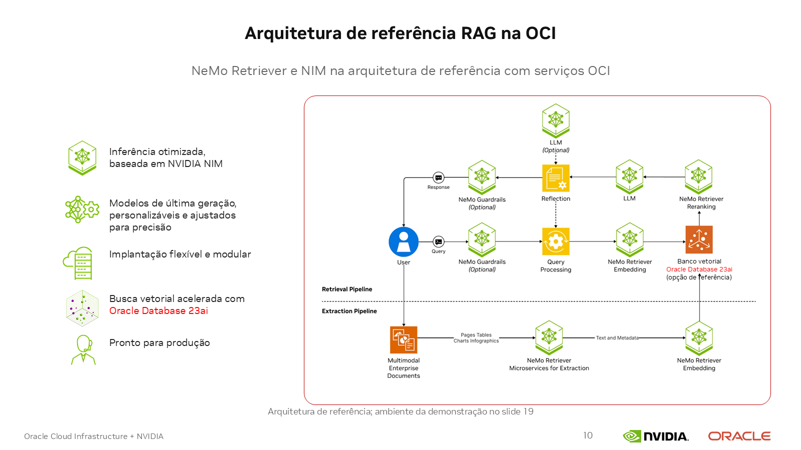
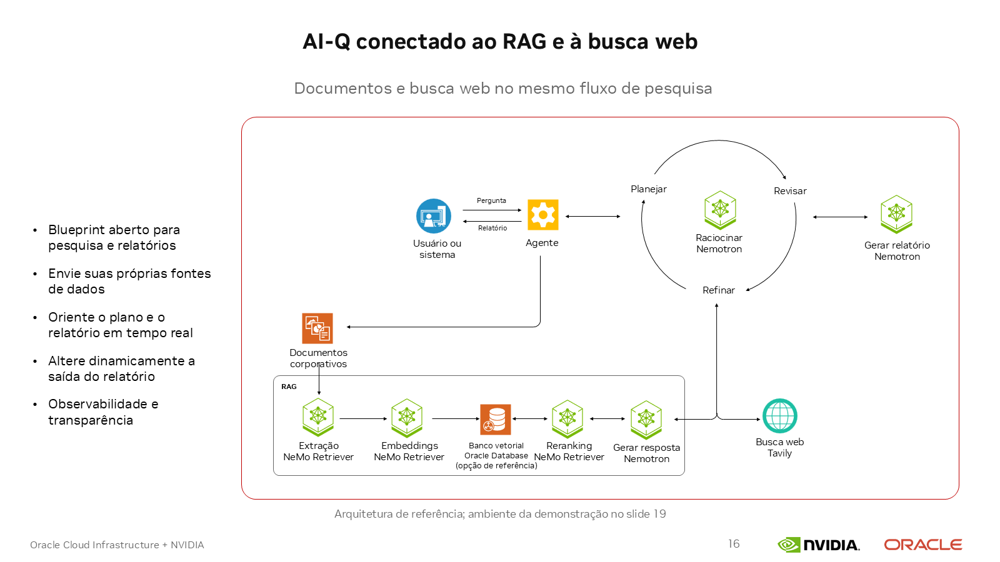

# Lab 2 — Assistente de pesquisa com NVIDIA AI-Q e RAG Blueprint

## Apresentação

Neste laboratório, você implantará um assistente de pesquisa em uma instância OCI com GPUs NVIDIA A100. A solução combina recuperação de documentos, pesquisa na web e geração de relatórios com fontes.

Ao concluir o laboratório, você conseguirá:

- Executar localmente o modelo Nemotron, os serviços de recuperação e os bancos de dados.
- Carregar documentos OCI e explorar um exemplo complementar com documentos financeiros.
- Consultar documentos no RAG Blueprint e gerar uma pesquisa combinada no AI-Q.
- Combinar documentos com pesquisa web pelo Tavily.
- Gerar, revisar e exportar um relatório.

Os arquivos oficiais NVIDIA são obtidos como submódulos Git. Dois patches ajustam suas configurações para as A100 e para a integração entre os serviços. Os comandos de implantação usam Docker Compose; a ingestão em lote usa o cliente oficial NVIDIA.

| Componente | Versão ou configuração |
| --- | --- |
| AI-Q | 2.2.1 |
| RAG Blueprint | 2.6.2; imagens das aplicações 2.6.0 |
| Modelo de linguagem | `nvidia/nemotron-3-super-120b-a12b` |
| Contêiner do modelo | NIM 2.0.9, perfil BF16 com paralelismo em quatro GPUs |
| Banco vetorial | Elasticsearch |
| Armazenamento de documentos | SeaweedFS |
| Sessões e tarefas AI-Q | PostgreSQL |
| Pesquisa web | Tavily |

A inferência e o processamento dos documentos são locais. Os downloads iniciais, o Tavily e os sites pesquisados utilizam a internet. As consultas enviadas ao Tavily saem da instância.

## Antes de começar

Você precisa de:

- Uma instância Linux x86_64 com oito GPUs A100 SXM4 de 80 GB. O mapa deste laboratório utiliza sete GPUs e mantém a GPU 6 fora da solução.
- Driver NVIDIA compatível com os NIMs, NVIDIA Container Toolkit e runtime NVIDIA configurado no Docker.
- Docker Engine 24 ou superior e Docker Compose 2.29.1 ou superior. Evite Docker Engine 29.5.x, excluído pela documentação desta release RAG por um problema de download de imagens NGC.
- Pelo menos 500 GiB livres no armazenamento usado para imagens, modelos e dados. Este roteiro usa `/data` como diretório de armazenamento rápido; o usuário precisa poder criar `/data/<usuario>`. O diretório de dados do Docker também precisa de espaço adequado.
- Git, curl, OpenSSL, um editor de texto como Nano e Python 3.10 ou superior com suporte a ambientes virtuais.
- Acesso SSH à instância, acesso ao repositório do laboratório, uma chave NGC e uma chave Tavily.
- Um computador com navegador e cliente SSH. Os comandos locais abaixo usam Bash, disponível em Linux, macOS ou WSL no Windows.

A matriz do RAG 2.6.2 usa Ubuntu 22.04 como sistema de referência. Confira também a compatibilidade dos NIMs antes de preparar o servidor:

- [Instalação do Docker Engine](https://docs.docker.com/engine/install/ubuntu/) e [plugin Docker Compose](https://docs.docker.com/compose/install/linux/).
- [Instalação do NVIDIA Container Toolkit](https://docs.nvidia.com/datacenter/cloud-native/container-toolkit/latest/install-guide.html).
- [Requisitos do RAG Blueprint 2.6.2](https://github.com/NVIDIA-AI-Blueprints/rag/blob/v2.6.2/docs/support-matrix.md).
- [Matriz de compatibilidade do NIM 2.0.9](https://docs.nvidia.com/nim/large-language-models/2.0.9/reference/support-matrix.html).

Execute um bloco de comando por vez, na ordem apresentada. Aguarde sua conclusão e confira o resultado antes de executar o próximo. Quando houver um comando de inicialização seguido de um teste da API, faça o teste somente após a inicialização terminar sem erro.

Este roteiro começa com um clone novo. Cada instalação terá seu próprio identificador, redes, contêineres e volumes; os caches ficam dentro do clone. As portas e GPUs do roteiro precisam estar livres: pare uma execução anterior antes de iniciar outra na mesma instância. Imagens já presentes no Docker podem ser reutilizadas sem compartilhar os dados das instalações.

Para continuar uma instalação existente, use a etapa **17.2**, preservando suas configurações. Não repita a preparação de uma instalação nova.

## 1. Conectar à instância

**No seu computador**, substitua o usuário, o endereço e o caminho da chave pelos dados do seu acesso OCI:

```bash
ssh -i ~/.ssh/id_ed25519 SEU_USUARIO_OCI@IP_DA_INSTANCIA
```

Execute os comandos de implantação **no servidor**, nessa sessão SSH e na raiz do clone. As etapas de túnel SSH e uso do navegador indicam explicitamente quando voltar ao seu computador.

Confira a infraestrutura:

Confira o usuário conectado.

```bash
whoami
```

Confira o nome da instância.

```bash
hostname
```

Confira a versão do Docker Engine.

```bash
docker --version
```

Confira a versão do Docker Compose.

```bash
docker compose version
```

Confira o diretório de dados e os runtimes do Docker.

```bash
docker info --format 'DockerRootDir={{.DockerRootDir}} Runtimes={{json .Runtimes}}'
```

Confira a versão do Python.

```bash
python3 --version
```

Confira o espaço disponível em `/data`.

```bash
df -h /data
```

Confira o uso das GPUs.

```bash
nvidia-smi --query-gpu=index,name,driver_version,memory.free --format=csv
```

**Resultado esperado:** Docker acessível pelo seu usuário, runtime `nvidia`, espaço suficiente e GPUs disponíveis. Cada GPU selecionada deve ter aproximadamente 70 GiB ou mais livres antes da inicialização dos modelos. Confirme com o administrador que essas GPUs estão reservadas para o laboratório.

## 2. Obter o laboratório e os repositórios NVIDIA

O repositório do laboratório é público e pode ser clonado sem autenticação GitHub. Para usar outra pasta, ajuste os comandos `mkdir` e `cd`.

Crie a pasta de trabalho no servidor.

```bash
mkdir -p /data/$USER
```

Entre na pasta de trabalho.

```bash
cd /data/$USER
```

Clone o repositório do laboratório.

```bash
git clone https://github.com/jpnavarro-nv/oci-aiq-rag-a100-lab.git oci-aiq-rag-a100-lab
```

Entre na raiz do clone.

```bash
cd oci-aiq-rag-a100-lab
```

Guarde o caminho da raiz do clone para os próximos comandos.

```bash
export LAB_ROOT="$PWD"
```

Sincronize os endereços dos submódulos.

```bash
git submodule sync --recursive
```

Obtenha o código dos submódulos NVIDIA nas versões do laboratório.

```bash
GIT_LFS_SKIP_SMUDGE=1 git submodule update --init --recursive --checkout
```

Confira o estado dos submódulos.

```bash
git submodule status
```

Os submódulos ficam em `upstream/aiq` e `upstream/rag`. Confirme os commits:

Confira o commit do AI-Q.

```bash
git -C upstream/aiq rev-parse HEAD
```

Confira o commit do RAG.

```bash
git -C upstream/rag rev-parse HEAD
```

**Resultado esperado:**

| Repositório | Commit |
| --- | --- |
| AI-Q | `6ec77d91cc5f3ba790729bb8bdc8189a821a61d3` |
| RAG | `f20716d73ae69a544ad4a692f38d6178a64e6f36` |

Mantenha esses commits durante o laboratório. As configurações e os patches correspondem a essas versões.

## 3. Preparar os diretórios e o mapa de GPUs

Continue na raiz do clone:

Proteja os novos arquivos criados nesta sessão.

```bash
umask 077
```

Informe o ID do seu usuário para os contêineres.

```bash
export USERID="$(id -u)"
```

Os NIMs com cache em `.local/cache` usam esse UID, para que os arquivos pertençam ao seu usuário e possam ser apagados por ele. O grupo interno permanece `0`, conforme a imagem NVIDIA; o processo não usa UID `0`. Bancos e dados persistentes dos serviços ficam em volumes gerenciados pelo Docker.

Defina a pasta dos arquivos Compose do RAG.

```bash
export RAG_COMPOSE_DIR="$LAB_ROOT/upstream/rag/deploy/compose"
```

Crie a pasta de cache do modelo de linguagem.

```bash
mkdir -p .local/cache/llm
```

Crie a pasta de cache de embeddings.

```bash
mkdir -p .local/cache/nemotron-vlm-embedding-ms
```

Crie a pasta de cache de reordenação.

```bash
mkdir -p .local/cache/nemotron-ranking-ms
```

Crie as pastas de documentos e relatórios.

```bash
mkdir -p .local/datasets .local/reports
```

Crie os arquivos de configuração a partir dos exemplos, executando um bloco por vez. `umask 077` restringe o acesso aos novos arquivos ao seu usuário.

```bash
cp -i config/lab.env.example config/lab.env
```

```bash
cp -i config/secrets.env.example config/secrets.env
```

```bash
chmod 600 config/secrets.env
```

Nesta instalação nova, gere um identificador para os recursos Docker:

```bash
export LAB_ID="lab2-$(openssl rand -hex 4)"
```

Salve-o na configuração desta cópia. Execute este bloco uma única vez por instalação:

```bash
printf '\nLAB_ID=%s\n' "$LAB_ID" >> config/lab.env
```

Defina o projeto RAG a partir desse identificador:

```bash
export RAG_PROJECT_NAME="${LAB_ID}-rag"
```

Abra a configuração:

```bash
nano config/lab.env
```

Confira o mapa inicial:

| Variável | GPU | Função |
| --- | --- | --- |
| `LLM_GPU_0` a `LLM_GPU_3` | 0, 1, 2, 3 | Modelo de linguagem compartilhado por AI-Q e RAG |
| `EMBEDDING_GPU` | 4 | Embeddings |
| `RERANKING_GPU` | 5 | Reordenação dos resultados |
| `INGEST_GPU` | 7 | Extração de documentos e OCR |
| — | 6 | Não utilizada pelo laboratório |

Se os IDs reservados forem diferentes, ajuste as variáveis. Use quatro GPUs distintas para o modelo e outras três para as demais funções.

Mantenha os valores iniciais de contexto e saída:

```text
LLM_CONTEXT=32768
LLM_OUTPUT_TOKENS=8192
```

Deixe `LLM_PROFILE` vazio até a etapa 5 e preserve o `LAB_ID` gerado. Ele identifica esta instalação mesmo quando você fecha o terminal.

No nano, salve com **Ctrl+O**, confirme com **Enter** e saia com **Ctrl+X**.

## 4. Configurar NGC e Tavily

### 4.1. Criar as chaves

1. Acesse [NGC](https://org.ngc.nvidia.com/setup/api-keys) e crie uma chave com acesso ao catálogo e aos contêineres necessários. Sua conta precisa estar autorizada a baixar os modelos utilizados.
2. Acesse [Tavily](https://app.tavily.com/), entre na sua conta e crie uma chave de API para pesquisa web.
3. Guarde as chaves para uso no servidor.

### 4.2. Preencher as credenciais

Gere uma senha para o PostgreSQL:

```bash
openssl rand -hex 24
```

Copie o valor gerado e abra o arquivo de credenciais:

```bash
nano config/secrets.env
```

Preencha os três campos com seus valores, sem espaços ao redor de `=`:

```text
NGC_API_KEY=SUA_CHAVE_NGC
TAVILY_API_KEY=SUA_CHAVE_TAVILY
LAB_DB_PASSWORD=SENHA_HEXADECIMAL_GERADA
```

Salve o arquivo e confirme sua proteção:

Restrinja o acesso ao arquivo de credenciais.

```bash
chmod 600 config/secrets.env
```

Confira se o Git ignora o arquivo de credenciais.

```bash
git check-ignore config/secrets.env
```

**Resultado esperado:** `config/secrets.env` aparece como arquivo ignorado pelo Git. Não envie esse arquivo a terceiros nem o inclua em capturas de tela.

### 4.3. Autenticar o Docker

Carregue a chave que você já salvou em `config/secrets.env`:

Carregue as credenciais salvas nesta sessão.

```bash
source config/secrets.env
```

Disponibilize a chave NGC para os próximos comandos.

```bash
export NGC_API_KEY
```

Autentique o Docker no NGC com a chave carregada.

```bash
printf '%s' "$NGC_API_KEY" | docker login nvcr.io --username '$oauthtoken' --password-stdin
```

Aguarde `Login Succeeded`. O Docker usa essa autenticação para baixar as imagens do NGC. Se já estiver autenticado, execute apenas os dois blocos de carregamento da chave acima; não precisa repetir o login.

## 5. Selecionar o perfil do modelo para as A100

A consulta abaixo utiliza as GPUs 0,1,2,3. Ajuste `NVIDIA_VISIBLE_DEVICES` se mudou os IDs na etapa 3. Execute a consulta com essas GPUs livres.

O NIM precisa da mesma chave para consultar os perfis e baixar os arquivos do modelo. O comando `-e NGC_API_KEY` usa a variável carregada na etapa 4.3. `--user "$USERID:0"` mantém os arquivos de cache sob seu UID. Se abriu outro terminal SSH, recarregue o ambiente pela etapa **17.2** antes de continuar.

```bash
docker run --rm --pull missing --user "$USERID:0" --runtime=nvidia \
  -e NVIDIA_VISIBLE_DEVICES=0,1,2,3 -e NGC_API_KEY \
  -v "$PWD/.local/cache/llm:/opt/nim/.cache" \
  nvcr.io/nim/nvidia/nemotron-3-super-120b-a12b:2.0.9 \
  list-model-profiles
```

Na seção de perfis compatíveis e executáveis, selecione um perfil:

- **BF16**: precisão utilizada nesta receita.
- **TP4**: modelo distribuído entre quatro GPUs.
- **Sem LoRA**: perfil de inferência padrão.

Copie o identificador completo do perfil e grave-o em `config/lab.env`:

```bash
nano config/lab.env
```

Preencha:

```text
LLM_PROFILE=IDENTIFICADOR_COMPLETO_DO_PERFIL_BF16_TP4
```

**Resultado esperado:** o perfil foi identificado como executável no seu servidor. Se não houver um perfil BF16 TP4 compatível, revise hardware, memória e versão da imagem antes de prosseguir.

## 6. Aplicar os patches de configuração

Continue na raiz do clone. A variável `LAB_ROOT` foi definida na etapa 2. Se abriu outra sessão SSH, recarregue o ambiente pela etapa **17.2** antes de continuar.

Liste os patches disponíveis.

```bash
ls patches/
```

Confira se os submódulos estão sem modificações:

Confira as alterações locais do RAG.

```bash
git -C upstream/rag status --short
```

Confira as alterações locais do AI-Q.

```bash
git -C upstream/aiq status --short
```

Em uma instalação nova, os comandos não devem mostrar alterações. Verifique a aplicação dos patches:

Confira se o patch do RAG pode ser aplicado.

```bash
git -C upstream/rag apply --check "$LAB_ROOT/patches/rag-v2.6.2-oci-a100.patch"
```

Confira se o patch do AI-Q pode ser aplicado.

```bash
git -C upstream/aiq apply --check "$LAB_ROOT/patches/aiq-v2.2.1-oci-a100.patch"
```

Se os dois comandos terminarem sem erro, aplique:

Aplique o patch de configuração do RAG.

```bash
git -C upstream/rag apply "$LAB_ROOT/patches/rag-v2.6.2-oci-a100.patch"
```

Aplique o patch de configuração do AI-Q.

```bash
git -C upstream/aiq apply "$LAB_ROOT/patches/aiq-v2.2.1-oci-a100.patch"
```

Confira o resumo das alterações do RAG.

```bash
git -C upstream/rag diff --stat
```

Confira o resumo das alterações do AI-Q.

```bash
git -C upstream/aiq diff --stat
```

**Resultado esperado:** quatro arquivos Compose modificados no RAG; um Compose e o workflow FRAG modificados no AI-Q. As alterações configuram GPUs, caches, modelos locais, portas e integração. O código das aplicações permanece o das releases NVIDIA.

Após essa etapa, é esperado que o Git mostre os submódulos como modificados. Não reaplique os patches em uma retomada. Se a verificação falhar, consulte a seção de solução de problemas.

Permita a leitura do arquivo de prompts que será montado nos contêineres RAG:

```bash
chmod a+r upstream/rag/src/nvidia_rag/rag_server/prompt.yaml
```

## 7. Validar o projeto RAG



Os [arquivos Compose oficiais do RAG Blueprint](https://github.com/NVIDIA-AI-Blueprints/rag/tree/v2.6.2/deploy/compose) são obtidos pelo submódulo `upstream/rag` e ficam em `upstream/rag/deploy/compose`.

O slide mostra a arquitetura de referência OCI; nesta receita, o banco vetorial implantado é Elasticsearch.

As variáveis RAG foram definidas nas etapas 2 e 3 e permanecem disponíveis na mesma sessão SSH. Cada comando indica o projeto com `-p` e seus arquivos com `-f`; as variáveis AI-Q serão definidas na etapa 11. `--profile lab2` seleciona os serviços RAG deste laboratório.

Valide os quatro arquivos oficiais RAG. Nenhum contêiner é iniciado nesta etapa:

```bash
docker compose -p "$RAG_PROJECT_NAME" --profile lab2 \
  -f "$RAG_COMPOSE_DIR/nims.yaml" \
  -f "$RAG_COMPOSE_DIR/vectordb.yaml" \
  -f "$RAG_COMPOSE_DIR/docker-compose-ingestor-server.yaml" \
  -f "$RAG_COMPOSE_DIR/docker-compose-rag-server.yaml" \
  --env-file config/lab.env --env-file config/secrets.env config --quiet
```

Liste os serviços:

```bash
docker compose -p "$RAG_PROJECT_NAME" --profile lab2 \
  -f "$RAG_COMPOSE_DIR/nims.yaml" \
  -f "$RAG_COMPOSE_DIR/vectordb.yaml" \
  -f "$RAG_COMPOSE_DIR/docker-compose-ingestor-server.yaml" \
  -f "$RAG_COMPOSE_DIR/docker-compose-rag-server.yaml" \
  --env-file config/lab.env --env-file config/secrets.env config --services
```

**Resultado esperado:** configuração válida e 14 serviços selecionados.

As inicializações usam `--pull missing --no-build`: imagens oficiais ausentes são baixadas; as existentes são reutilizadas. Os pesos e artefatos dos NIMs são armazenados nos caches quando aplicável. A primeira inicialização pode demorar mais que as seguintes.

## 8. Iniciar os modelos locais

### 8.1. Modelo de linguagem

Inicie os serviços e aguarde a conclusão do comando.

```bash
docker compose -p "$RAG_PROJECT_NAME" --profile lab2 \
  -f "$RAG_COMPOSE_DIR/nims.yaml" \
  -f "$RAG_COMPOSE_DIR/vectordb.yaml" \
  -f "$RAG_COMPOSE_DIR/docker-compose-ingestor-server.yaml" \
  -f "$RAG_COMPOSE_DIR/docker-compose-rag-server.yaml" \
  --env-file config/lab.env --env-file config/secrets.env up -d --pull missing --no-build --wait --wait-timeout 7200 nim-llm
```

Depois que o Compose terminar sem erro, confira o modelo disponível na API.

```bash
curl -fsS --max-time 30 http://127.0.0.1:18999/v1/models
```

**Resultado esperado:** contêiner saudável e modelo `nvidia/nemotron-3-super-120b-a12b` listado na resposta. O cache do modelo deve pertencer ao mesmo usuário da sessão.

**Teste de resposta em linguagem natural.** O arquivo `checks/llm-chat.json` envia a pergunta: “O que é o OCI Supercluster?”. Execute:

```bash
curl --fail-with-body --max-time 300 http://127.0.0.1:18999/v1/chat/completions \
  -H 'Content-Type: application/json' --data-binary @checks/llm-chat.json
```

**Resultado esperado:** a resposta JSON contém uma explicação em português no campo `choices[0].message.content`. Exemplo ilustrativo do texto, que pode variar entre execuções:

```text
O OCI Supercluster é uma infraestrutura da Oracle Cloud que combina
servidores bare metal com GPUs e uma rede de alto desempenho e baixa
latência. Ela atende cargas exigentes, como treinamento e inferência
de modelos de inteligência artificial e computação de alto desempenho.
```

Esse teste consulta somente o modelo local. A recuperação de documentos e a busca web serão testadas nas próximas etapas. Para referência sobre o conceito, consulte a [página de infraestrutura de IA da Oracle](https://www.oracle.com/ai-infrastructure/).

Após confirmar a resposta do modelo, continue na etapa 8.2.

### 8.2. Embeddings e reordenação

```bash
docker compose -p "$RAG_PROJECT_NAME" --profile lab2 \
  -f "$RAG_COMPOSE_DIR/nims.yaml" \
  -f "$RAG_COMPOSE_DIR/vectordb.yaml" \
  -f "$RAG_COMPOSE_DIR/docker-compose-ingestor-server.yaml" \
  -f "$RAG_COMPOSE_DIR/docker-compose-rag-server.yaml" \
  --env-file config/lab.env --env-file config/secrets.env up -d --pull missing --no-build --wait --wait-timeout 3600 nemotron-vlm-embedding-ms nemotron-ranking-ms
```

**Resultado esperado:** os dois serviços saudáveis nas GPUs configuradas para embeddings e reordenação; o mapa padrão utiliza as GPUs 4 e 5.

### 8.3. Extração de documentos e OCR

Inicie os serviços e aguarde a conclusão do comando.

```bash
docker compose -p "$RAG_PROJECT_NAME" --profile lab2 \
  -f "$RAG_COMPOSE_DIR/nims.yaml" \
  -f "$RAG_COMPOSE_DIR/vectordb.yaml" \
  -f "$RAG_COMPOSE_DIR/docker-compose-ingestor-server.yaml" \
  -f "$RAG_COMPOSE_DIR/docker-compose-rag-server.yaml" \
  --env-file config/lab.env --env-file config/secrets.env up -d --pull missing --no-build --wait --wait-timeout 3600 page-elements graphic-elements table-structure nemotron-ocr
```

Confira o estado dos contêineres do RAG.

```bash
docker compose -p "$RAG_PROJECT_NAME" --profile lab2 \
  -f "$RAG_COMPOSE_DIR/nims.yaml" \
  -f "$RAG_COMPOSE_DIR/vectordb.yaml" \
  -f "$RAG_COMPOSE_DIR/docker-compose-ingestor-server.yaml" \
  -f "$RAG_COMPOSE_DIR/docker-compose-rag-server.yaml" \
  --env-file config/lab.env --env-file config/secrets.env ps
```

Confira o uso das GPUs.

```bash
nvidia-smi
```

**Resultado esperado:** os quatro serviços de extração saudáveis na GPU configurada em `INGEST_GPU`; o mapa padrão utiliza a GPU 7 e mantém a GPU 6 fora da solução. Esta configuração processa texto/PDF; extração de tabelas, gráficos, imagens e geração de legendas ficam desativadas.

## 9. Iniciar bancos, ingestão e RAG

### 9.1. Elasticsearch e SeaweedFS

```bash
docker compose -p "$RAG_PROJECT_NAME" --profile lab2 \
  -f "$RAG_COMPOSE_DIR/nims.yaml" \
  -f "$RAG_COMPOSE_DIR/vectordb.yaml" \
  -f "$RAG_COMPOSE_DIR/docker-compose-ingestor-server.yaml" \
  -f "$RAG_COMPOSE_DIR/docker-compose-rag-server.yaml" \
  --env-file config/lab.env --env-file config/secrets.env up -d --pull missing --no-build --wait --wait-timeout 600 elasticsearch seaweedfs
```

### 9.2. Serviço de ingestão

Inicie os serviços e aguarde a conclusão do comando.

```bash
docker compose -p "$RAG_PROJECT_NAME" --profile lab2 \
  -f "$RAG_COMPOSE_DIR/nims.yaml" \
  -f "$RAG_COMPOSE_DIR/vectordb.yaml" \
  -f "$RAG_COMPOSE_DIR/docker-compose-ingestor-server.yaml" \
  -f "$RAG_COMPOSE_DIR/docker-compose-rag-server.yaml" \
  --env-file config/lab.env --env-file config/secrets.env up -d --pull missing --no-build --wait --wait-timeout 1200 redis nv-ingest-ms-runtime ingestor-server
```

Confira a saúde da API de ingestão e suas dependências.

```bash
curl -fsS --retry 30 --retry-delay 2 --retry-connrefused --retry-max-time 180 --max-time 30 \
  'http://127.0.0.1:18082/v1/health?check_dependencies=true'
```

**Resultado esperado:** ingestão e dependências com estado `healthy`. Leia os estados na resposta JSON; não verifique apenas se o contêiner está em execução.

### 9.3. API e interface RAG

Inicie os serviços e aguarde a conclusão do comando.

```bash
docker compose -p "$RAG_PROJECT_NAME" --profile lab2 \
  -f "$RAG_COMPOSE_DIR/nims.yaml" \
  -f "$RAG_COMPOSE_DIR/vectordb.yaml" \
  -f "$RAG_COMPOSE_DIR/docker-compose-ingestor-server.yaml" \
  -f "$RAG_COMPOSE_DIR/docker-compose-rag-server.yaml" \
  --env-file config/lab.env --env-file config/secrets.env up -d --pull missing --no-build --wait --wait-timeout 1200 rag-server rag-frontend
```

Confira a saúde da API RAG e suas dependências.

```bash
curl -fsS --retry 30 --retry-delay 2 --retry-connrefused --retry-max-time 180 --max-time 30 \
  'http://127.0.0.1:18081/v1/health?check_dependencies=true'
```

**Resultado esperado:** RAG e dependências saudáveis. Os volumes de dados usam o identificador `LAB_ID` desta instalação.

## 10. Abrir a interface RAG e consultar o primeiro PDF

### 10.1. Abrir um túnel SSH

**No seu computador**, abra uma nova aba de terminal Bash ou WSL para o túnel RAG. Mantenha sua sessão SSH de administração aberta em outra aba para os comandos no servidor.

Execute os blocos abaixo no terminal local, antes de entrar por SSH. O prompt não deve mostrar o nome da instância OCI: a chave privada está no seu computador.

Substitua `SEU_USUARIO_OCI@IP_DA_INSTANCIA` em `OCI_SSH_DESTINO` pelo usuário e IP do seu acesso e ajuste `OCI_SSH_CHAVE` para sua chave privada.

Defina o usuário e o IP da instância.

```bash
export OCI_SSH_DESTINO="SEU_USUARIO_OCI@IP_DA_INSTANCIA"
```

Defina o caminho da chave privada no seu computador.

```bash
export OCI_SSH_CHAVE="$HOME/.ssh/id_ed25519"
```

Abra o túnel e mantenha essa aba de terminal aberta.

```bash
ssh -i "$OCI_SSH_CHAVE" -N -o ExitOnForwardFailure=yes \
  -L 19090:127.0.0.1:19090 \
  -L 18081:127.0.0.1:18081 \
  -L 18082:127.0.0.1:18082 \
  "$OCI_SSH_DESTINO"
```

Mantenha essa aba aberta; é normal ficar sem imprimir mensagens. O túnel encaminha as portas abaixo para seu computador:

| Serviço | Endereço local |
| --- | --- |
| RAG Playground | [http://localhost:19090](http://localhost:19090) |
| API RAG | [http://localhost:18081](http://localhost:18081) |
| API de ingestão | [http://localhost:18082](http://localhost:18082) |

### 10.2. Carregar o PDF OCI

1. No navegador do seu computador, baixe o [PDF sobre OCI Supercluster](https://www.oracle.com/a/ocom/docs/cloud/accelerate-ai-with-oci-supercluster.pdf).
2. Abra [RAG Playground](http://localhost:19090).
3. Clique em **New Collection** e crie a coleção `oci_lab2`.
4. Use a opção de adicionar arquivos da coleção para enviar o PDF.
5. Aguarde o processamento terminar e selecione a coleção.
6. Envie a pergunta:

```text
O que é OCI Supercluster e quais vantagens o documento descreve? Cite as fontes utilizadas.
```

**Resultado esperado:** resposta baseada no PDF, com referências que podem ser conferidas no documento. Na próxima etapa, volte à sessão SSH de administração no servidor, mantendo o túnel RAG aberto.

## 11. Implantar o AI-Q integrado ao RAG



Os [arquivos Compose oficiais do AI-Q](https://github.com/NVIDIA-AI-Blueprints/deep-researcher-agent/tree/v2.2.1/deploy/compose) são obtidos pelo submódulo `upstream/aiq` e ficam em `upstream/aiq/deploy/compose`.

### 11.1. Iniciar os serviços AI-Q

No terminal do **servidor**, na raiz do clone, defina as variáveis do AI-Q antes de iniciá-lo:

Defina o nome do projeto AI-Q.

```bash
export AIQ_PROJECT_NAME="${LAB_ID}-aiq"
```

Defina o arquivo Compose oficial do AI-Q no clone atual.

```bash
export AIQ_COMPOSE_FILE="$PWD/upstream/aiq/deploy/compose/docker-compose.yaml"
```

Permita que o usuário do contêiner leia o diretório de configurações NVIDIA, que é montado em `/app/configs`:

```bash
chmod -R a+rX upstream/aiq/configs
```

Permita a leitura do script oficial que inicializa os bancos PostgreSQL:

```bash
chmod a+r upstream/aiq/deploy/compose/init-db.sql
```

Inicie `postgres`, `aiq-agent` e `frontend`. O RAG continua em execução e fornece o modelo de linguagem e os serviços de documentos:

```bash
docker compose -p "$AIQ_PROJECT_NAME" -f "$AIQ_COMPOSE_FILE" \
  --env-file config/lab.env --env-file config/secrets.env up -d --pull missing --no-build --wait --wait-timeout 1200 postgres aiq-agent frontend
```

Quando o Compose terminar sem erro, confira a saúde do backend. É este teste HTTP que confirma que a API está atendendo:

```bash
curl -fsS --retry 30 --retry-delay 2 --retry-all-errors --retry-max-time 180 --max-time 30 http://127.0.0.1:18000/health
```

**Resultado esperado:** a resposta contém os campos abaixo, confirmando que o backend, o Dask e o banco de dados estão disponíveis:

```json
{
  "status": "healthy",
  "dask_available": true,
  "db": "ok"
}
```

Com esse resultado, a etapa 11.1 está concluída. Continue na **11.2**, no seu computador, para abrir o túnel AI-Q. Em seguida, vá direto às etapas **13 e 14** para pesquisar com PDF + web e exportar o relatório. A etapa financeira 12 é opcional.

### 11.2. Abrir o túnel AI-Q

Depois de confirmar o backend saudável, **no seu computador**, abra outra aba de terminal Bash ou WSL para o túnel AI-Q. Execute os blocos abaixo nessa aba local, sem entrar antes por SSH. Mantenha a aba do túnel RAG aberta. Esta aba adicional serve somente ao encaminhamento de portas; todos os comandos de implantação continuam na sessão SSH original.

Preencha novamente o destino e a chave nesta nova aba; as variáveis não são compartilhadas entre terminais já abertos.

Defina o usuário e o IP da instância.

```bash
export OCI_SSH_DESTINO="SEU_USUARIO_OCI@IP_DA_INSTANCIA"
```

Defina o caminho da chave privada no seu computador.

```bash
export OCI_SSH_CHAVE="$HOME/.ssh/id_ed25519"
```

Abra o túnel e mantenha essa aba de terminal aberta.

```bash
ssh -i "$OCI_SSH_CHAVE" -N -o ExitOnForwardFailure=yes \
  -L 13000:127.0.0.1:13000 \
  -L 18000:127.0.0.1:18000 \
  "$OCI_SSH_DESTINO"
```

Mantenha essa aba aberta e acesse [AI-Q](http://localhost:13000) no navegador. É normal o túnel ficar sem imprimir mensagens. A API fica disponível em [http://localhost:18000](http://localhost:18000).

Você pode manter RAG e AI-Q em janelas do navegador lado a lado. **Ctrl+C** encerra apenas o túnel da respectiva aba, sem parar os contêineres no servidor.

## 12. Exemplo complementar: documentos financeiros

O fluxo principal continua com o PDF OCI Supercluster na etapa 13. Esta etapa é opcional: ela mostra como carregar vários PDFs no RAG usando um conjunto financeiro disponibilizado no repositório oficial NVIDIA AI-Q. Os documentos permitem explorar perguntas sobre crédito comercial.

### 12.1. Baixar e extrair os arquivos

Volte ao terminal do **servidor**, na raiz do clone, e baixe o conjunto financeiro. Se já baixou e extraiu os documentos, continue na etapa 12.2.

```bash
curl -fL --retry 3 -o .local/datasets/Financial_Dataset.zip \
  https://media.githubusercontent.com/media/NVIDIA-AI-Blueprints/deep-researcher-agent/afc3e6bd6c21176baea5a289457f2a39229d2f66/data/files/Financial_Dataset.zip
```

Extraia o conjunto financeiro:

```bash
python3 -m zipfile -e .local/datasets/Financial_Dataset.zip .local/datasets/Financial_Dataset
```

### 12.2. Preparar os clientes oficiais NVIDIA

Crie o ambiente Python dos clientes NVIDIA.

```bash
python3 -m venv .venv-nvidia
```

Instale as dependências dos clientes oficiais.

```bash
.venv-nvidia/bin/python -m pip install -r upstream/rag/scripts/requirements.txt
```

### 12.3. Ingerir a coleção no RAG

Carregue os documentos financeiros:

```bash
.venv-nvidia/bin/python upstream/rag/scripts/batch_ingestion.py \
  --folder .local/datasets/Financial_Dataset --collection-name financial_lab2 \
  --create_collection --ingestor-host 127.0.0.1 --ingestor-port 18082 \
  --upload-batch-size 2 --allowed-exts .pdf
```

**Resultado esperado:** os documentos processados e a coleção `financial_lab2` disponível no RAG Playground. Se a coleção já existir em uma retomada, retire `--create_collection`.

### 12.4. Consultar a coleção

```bash
.venv-nvidia/bin/python upstream/rag/scripts/retriever_api_usage.py \
  --host http://127.0.0.1:18081 --collection-name financial_lab2 \
  'Quais tendências de crédito comercial são descritas nos documentos?'
```

**Resultado esperado:** resposta vinculada aos documentos da coleção financeira.

## 13. Preparar uma sessão AI-Q com PDF e pesquisa web

Na versão 2.2.1, o AI-Q utiliza arquivos associados a cada sessão. As coleções criadas no RAG Playground não são selecionadas automaticamente na interface AI-Q; anexe os documentos à sessão em que serão utilizados.

### 13.1. Selecionar o PDF OCI

Use no seu computador o mesmo [PDF sobre OCI Supercluster](https://www.oracle.com/a/ocom/docs/cloud/accelerate-ai-with-oci-supercluster.pdf) baixado na etapa 10.2. Você vai anexá-lo diretamente à sessão AI-Q, sem precisar copiar arquivos do servidor.

### 13.2. Criar uma sessão nova

1. No seu computador, abra uma janela anônima do navegador (**Ctrl+Shift+N** no Chrome) e acesse [AI-Q](http://localhost:13000), mantendo o túnel ativo.
2. Clique em **Sessions → New Session**. Também é possível iniciar uma sessão clicando no logotipo **AI-Q**, no canto superior esquerdo.
3. Confirme que aparece a tela **Welcome to AI-Q**, sem mensagens da pesquisa anterior.

A janela anônima evita reutilizar o histórico salvo no navegador durante este teste. No uso normal, o botão **New Session** é suficiente; não é necessário apagar o histórico nem reiniciar os contêineres. Abrir apenas outra aba no mesmo navegador pode restaurar a sessão anterior.

### 13.3. Selecionar as duas fontes

1. Abra **Data Sources → Files**, clique em **Choose files** e selecione o PDF OCI Supercluster.
2. Aguarde o processamento terminar e confirme que o PDF aparece na sessão.
3. Em **Connections**, habilite **Web Search**.
4. Feche o painel e continue na etapa 14.

**Resultado esperado:** uma sessão nova com o PDF anexado e Web Search habilitada. Não é preciso executar uma consulta somente ao PDF. Respeite os limites mostrados na interface: até 100 MB por arquivo e até dez arquivos por envio nesta configuração.

## 14. Gerar, revisar e exportar o relatório

### 14.1. Combinar documentos e pesquisa web

Na sessão preparada na etapa 13, envie a pesquisa abaixo. O escopo é curto para facilitar a demonstração:

```text
Redija todo o relatório em português do Brasil, incluindo título e subtítulos.

Usando o PDF anexado e pesquisa web em fontes oficiais Oracle e NVIDIA, explique como OCI Supercluster e NVIDIA se complementam para executar soluções de IA.

Escreva um relatório curto em português, com até 600 palavras e uma tabela de três linhas: GPUs, rede e software NVIDIA. Diferencie o que vem do PDF e o que foi encontrado na web.

Inclua citações [1], [2] no texto e uma seção final “Sources” com as referências numeradas, preservando os identificadores e URLs retornados pelas ferramentas. Não invente fontes. Prossiga sem solicitar esclarecimentos.
```

Se o agente pedir esclarecimentos, responda com o foco e o nível de detalhe desejados. Para prosseguir sem acrescentar detalhes, digite `skip`.

Acompanhe a pesquisa até o estado **Done** e a disponibilização do relatório. O tempo depende do número de chamadas ao modelo e das fontes pesquisadas.

**Resultado esperado:** relatório disponível para leitura e exportação, com referências do PDF e da web. Confira o uso das duas fontes em **Show thinking / Show Research** e abra algumas referências. A seleção das fontes, sozinha, não comprova que ambas foram consultadas. Se aparecer **Report Failed to Complete**, o teste falhou mesmo que outro cartão mostre **Done**; consulte a etapa 18.

### 14.2. Refinar o conteúdo

Opcionalmente, envie uma mensagem curta na mesma sessão para demonstrar o refinamento:

```text
Resuma o relatório em português do Brasil, em cinco pontos para uma apresentação sobre OCI e NVIDIA. Preserve as citações e a seção Sources.
```

Aguarde a conclusão e compare o conteúdo refinado com a versão anterior.

### 14.3. Exportar

Abra o relatório no painel de visualização. No rodapé de exportação, selecione **PDF** ou **Markdown**. A exportação fica disponível quando a pesquisa termina.

Salve o arquivo no seu computador e confira o conteúdo e a lista de fontes no documento exportado.

## 15. Explorar outros cenários

Crie uma sessão para cada conjunto documental e repita o fluxo de upload e pesquisa combinada. Para o exemplo financeiro, baixe o [ZIP financeiro](https://media.githubusercontent.com/media/NVIDIA-AI-Blueprints/deep-researcher-agent/afc3e6bd6c21176baea5a289457f2a39229d2f66/data/files/Financial_Dataset.zip) no seu computador, extraia os PDFs e anexe-os a uma nova sessão AI-Q conforme a etapa 13.

| Documentos da sessão | Pergunta de pesquisa |
| --- | --- |
| PDF OCI Supercluster | Compare as capacidades de inteligência artificial da OCI descritas no PDF com as tendências atuais do setor |
| PDFs financeiros | Qual é o impacto das mudanças nas taxas de juros sobre os imóveis comerciais? |

## 16. Registrar os resultados

O relatório exportado é o principal resultado do laboratório.

Use a lista abaixo para conferir a conclusão do laboratório:

- [ ] Modelo local respondeu à pergunta sobre OCI Supercluster.
- [ ] Embeddings, reordenação, extração, bancos e APIs estão saudáveis.
- [ ] O PDF OCI foi processado no RAG e anexado à sessão AI-Q.
- [ ] A consulta RAG retornou evidências dos documentos corretos.
- [ ] A sessão AI-Q contém o PDF OCI e Web Search habilitada.
- [ ] A pesquisa combinada consultou o PDF e fontes web.
- [ ] O relatório concluiu sem erro, foi exportado e teve suas fontes conferidas.

## 17. Parar e retomar

### 17.1. Parar preservando dados

No terminal do servidor, na raiz do clone, conclua ou cancele pesquisas ativas. Se abriu outra sessão SSH, carregue primeiro as variáveis pela etapa **17.2** e as variáveis AI-Q da **11.1**. Pare primeiro o AI-Q e depois o RAG:

Pare os contêineres do AI-Q.

```bash
docker ps -q --filter "label=com.docker.compose.project=${AIQ_PROJECT_NAME:?defina as variaveis AI-Q da etapa 11.1}" | xargs -r docker stop --time 120
```

Pare os contêineres do RAG.

```bash
docker ps -q --filter "label=com.docker.compose.project=${RAG_PROJECT_NAME:?carregue o ambiente da etapa 17.2}" | xargs -r docker stop --time 120
```

Os comandos selecionam somente os dois projetos do laboratório. Contêineres, imagens, volumes e caches ficam preservados.

### 17.2. Retomar em uma nova sessão SSH

Na raiz do clone em uso, reconstrua o contexto do terminal:

Guarde o caminho da raiz do clone para os próximos comandos.

```bash
export LAB_ROOT="$PWD"
```

Informe o ID do seu usuário para os contêineres.

```bash
export USERID="$(id -u)"
```

Carregue a configuração já preenchida desta cópia:

```bash
source config/lab.env
```

Disponibilize o identificador salvo, sem gerar outro:

```bash
export LAB_ID
```

Defina o nome do projeto RAG desta instalação:

```bash
export RAG_PROJECT_NAME="${LAB_ID}-rag"
```

Defina a pasta dos arquivos Compose do RAG.

```bash
export RAG_COMPOSE_DIR="$LAB_ROOT/upstream/rag/deploy/compose"
```

Carregue as credenciais existentes:

```bash
source config/secrets.env
```

Disponibilize a chave NGC para os comandos de perfis:

```bash
export NGC_API_KEY
```

Mantenha os arquivos `config/lab.env` e `config/secrets.env`, incluindo o `LAB_ID` e a senha PostgreSQL. Não gere um novo identificador para retomar a mesma instalação.

Se os contêineres continuam executando, volte ao ponto em que parou. Para comandos AI-Q, recarregue também as duas variáveis da etapa **11.1**; as definições acima preparam o contexto comum e o RAG. Se os serviços foram parados, repita as etapas **7, 8, 9 e 11.1**. Não reaplique os patches nem crie novamente as coleções. Os volumes identificados por `LAB_ID` e os caches deste clone serão reutilizados.

Se apenas o AI-Q foi parado e o RAG continua ativo, retome pela etapa 11.1. Se também fechou as abas dos túneis no seu computador, reabra o RAG pela etapa 10.1 e o AI-Q pela etapa 11.2.

### 17.3. Recriar contêineres sem apagar dados

Com os serviços parados, remova somente os contêineres dos dois projetos:

Remova os contêineres parados do AI-Q, preservando os volumes.

```bash
docker ps -aq --filter "label=com.docker.compose.project=${AIQ_PROJECT_NAME:?defina as variaveis AI-Q da etapa 11.1}" | xargs -r docker rm
```

Remova os contêineres parados do RAG, preservando os volumes.

```bash
docker ps -aq --filter "label=com.docker.compose.project=${RAG_PROJECT_NAME:?carregue o ambiente da etapa 17.2}" | xargs -r docker rm
```

Depois, siga a retomada. A remoção dos contêineres não esvazia os bancos: os volumes persistentes continuam existentes.

## 18. Solução de problemas

### Download de imagem ou modelo falhou

Confira a tag indicada no erro, o acesso à internet e a autorização da chave NGC. Repita o login da etapa 4.3 se necessário. Após corrigir, repita somente o comando do serviço que falhou.

### O patch não aplica

Confira os commits da etapa 2 e as alterações locais:

Confira o resumo das alterações do RAG.

```bash
git -C upstream/rag diff --stat
```

Confira o resumo das alterações do AI-Q.

```bash
git -C upstream/aiq diff --stat
```

Confira se o patch do RAG já está aplicado.

```bash
git -C upstream/rag apply --reverse --check "$LAB_ROOT/patches/rag-v2.6.2-oci-a100.patch"
```

Confira se o patch do AI-Q já está aplicado.

```bash
git -C upstream/aiq apply --reverse --check "$LAB_ROOT/patches/aiq-v2.2.1-oci-a100.patch"
```

Continue pela etapa 7 somente se **as duas verificações inversas** passarem, confirmando que ambos os patches já estão aplicados. Se apenas uma passar, confira o outro submódulo e conclua sua configuração conforme a etapa 6. Em outra falha, compare o commit e os arquivos modificados antes de editar. Não use aplicação forçada para contornar diferenças de versão.

### Serviço demorando para iniciar

Confira o estado dos contêineres e os logs:

Confira o estado dos contêineres do RAG.

```bash
docker ps -a --filter "label=com.docker.compose.project=${RAG_PROJECT_NAME:?carregue o ambiente RAG}" --format 'table {{.Names}}\t{{.Status}}'
```

Confira o estado dos contêineres do AI-Q.

```bash
docker ps -a --filter "label=com.docker.compose.project=${AIQ_PROJECT_NAME:?carregue o ambiente AI-Q}" --format 'table {{.Names}}\t{{.Status}}'
```

Consulte os logs do modelo de linguagem.

```bash
docker logs --tail 80 "${LAB_ID:?carregue o ambiente da etapa 17.2}-rag-nim-llm"
```

Consulte os logs do backend AI-Q.

```bash
docker logs --tail 80 "${LAB_ID:?carregue o ambiente da etapa 17.2}-aiq-agent"
```

Confira o uso das GPUs.

```bash
nvidia-smi --query-gpu=index,utilization.gpu,memory.used --format=csv
```

O primeiro carregamento pode incluir downloads e preparação dos modelos. Um timeout de espera não apaga os caches. Verifique o progresso antes de recriar o serviço.

### Erro de memória ou perfil incompatível

Confirme a reserva das GPUs, a memória livre e o perfil BF16 TP4 escolhido. Não encerre processos de outros usuários. Execute a consulta de perfis somente quando as quatro GPUs do LLM estiverem livres.

### A interface não abre

Confira se a aba do túnel correspondente continua aberta e se está acessando o endereço `localhost` da etapa 10.1 (RAG) ou 11.2 (AI-Q). Se uma porta local já estiver ocupada, encerre o túnel que está usando essa porta ou utilize outra porta local no encaminhamento.

Se o SSH informar que a chave não existe e o prompt mostrar o nome da instância OCI, o túnel foi executado no servidor. Abra uma aba Bash/WSL no seu computador e execute os blocos locais da etapa correspondente.

### A interface restaurou uma conversa anterior

O navegador pode guardar o histórico em `localhost:13000`, independentemente da pasta clonada no servidor. Clique em **Sessions → New Session** ou use uma janela anônima para o teste da etapa 13. O histórico exibido, por si só, não indica compartilhamento de cache entre instalações.

### O relatório falhou com CitationIntegrityError

Esse erro indica que o AI-Q não conseguiu preservar citações verificáveis no relatório final. Um log como `No source section found in report` aponta que o texto não trouxe referências no formato reconhecido. A API pode estar saudável mesmo quando uma pesquisa falha.

No servidor, na raiz do clone e com as variáveis da etapa 11.1 carregadas, consulte os logs do agente:

```bash
docker compose -p "$AIQ_PROJECT_NAME" -f "$AIQ_COMPOSE_FILE" \
  --env-file config/lab.env --env-file config/secrets.env logs --since 15m --tail 200 aiq-agent
```

Confira o erro e o Job ID. Crie uma sessão nova, aguarde o upload do PDF, habilite Web Search e repita o pedido da etapa **14.1**, que solicita citações numeradas e a seção **Sources**. Esse formato orienta o modelo, mas não substitui a validação: confirme que o relatório ficou disponível e que as referências sustentam o texto. Não desative a checagem de citações para considerar o teste concluído.

### Uma nova instalação encontra portas ou GPUs ocupadas

Uma nova cópia recebe outro `LAB_ID` e não reutiliza redes, contêineres ou volumes da anterior. Isso não encerra serviços antigos nem libera suas portas e GPUs. Pare a instalação que estiver utilizando esses recursos antes de iniciar outra. Preserve o `LAB_ID` ao retomar a mesma cópia; não copie o `config/lab.env` de outra instalação para um teste limpo.

### AI-Q: permissão negada ao ler a configuração

Se os logs mostrarem `PermissionError` ao abrir `/app/configs/config_web_frag.yml`, o usuário do contêiner não consegue ler as configurações montadas do servidor. Na raiz do clone, libere a leitura desse diretório:

```bash
chmod -R a+rX upstream/aiq/configs
```

Repita a inicialização do AI-Q e o teste HTTP da etapa 11.1. Continue para o túnel somente quando a API responder com estado `healthy`.

### Ingestão ou dependência indisponível

Confira a saúde da API de ingestão e suas dependências.

```bash
curl -fsS --max-time 60 'http://127.0.0.1:18082/v1/health?check_dependencies=true'
```

Confira a saúde da API RAG e suas dependências.

```bash
curl -fsS --max-time 60 'http://127.0.0.1:18081/v1/health?check_dependencies=true'
```

Confira a saúde do backend AI-Q.

```bash
curl -fsS --max-time 60 http://127.0.0.1:18000/health
```

Identifique a dependência com falha na resposta e consulte os logs do contêiner correspondente. Em uma carga já criada, retome o cliente de ingestão sem `--create_collection`.

### Pesquisa web não retorna resultados

Confira se **Web Search** está habilitada na sessão, se a chave Tavily é válida e se há quota disponível. Consulte os logs do AI-Q para identificar falhas do provedor. Após alterar `config/secrets.env`, recarregue as credenciais e atualize o serviço AI-Q:

Carregue as credenciais salvas nesta sessão.

```bash
source config/secrets.env
```

Disponibilize as credenciais carregadas para os próximos comandos.

```bash
export NGC_API_KEY TAVILY_API_KEY LAB_DB_PASSWORD
```

Inicie os serviços e aguarde a conclusão do comando.

```bash
docker compose -p "$AIQ_PROJECT_NAME" -f "$AIQ_COMPOSE_FILE" \
  --env-file config/lab.env --env-file config/secrets.env up -d --pull missing --no-build aiq-agent
```

Ao compartilhar um erro, remova chaves, senhas e dados privados. Não compartilhe `config/secrets.env`, ambientes completos de contêineres ou a configuração Compose expandida.

## 19. Alternativa: Lightning 30B em duas A100

Esta alternativa troca somente o modelo de linguagem compartilhado por RAG e AI-Q por **Nemotron 3.5 Lightning 30B-A3B, NIM 2.0.13, BF16 TP2**. Os agentes, ferramentas, bancos, embeddings e extração continuam iguais. O upstream AI-Q usa também Ultra para pesquisa profunda; executar todos os papéis com Lightning é uma adaptação deste laboratório, cuja conclusão de relatórios precisa ser validada.

**Alternativa experimental.** Na validação de 05/11/2026 em duas A100 de 80 GB, passaram chat, chamadas de ferramentas e resposta RAG ao PDF com fontes. A pesquisa profunda consultou PDF e web, mas terminou sem gravar o relatório (`writer_output_not_committed`). Portanto, esta alternativa está disponível para testes de inferência e integração; a geração completa de relatórios ainda não foi aprovada. Não há ganho de tempo do relatório comprovado.

Execute na raiz do clone, após aplicar os patches da etapa 6. Se retomou em outro terminal, carregue o ambiente da etapa 17.2 e as variáveis AI-Q da 11.1. Preserve `config/lab.env`: ele permite voltar ao Super 120B.

### 19.1. Preparar o modelo

Na primeira ativação desta alternativa, confira o patch adicional AI-Q. Ele restaura os limites de saída por papel (32.768 para pesquisa superficial, 16.384 para pesquisa profunda e 32.768 para escrita), desativa chamadas paralelas nos dois papéis originalmente Ultra e encerra cada chamada de ferramenta no marcador `</tool_call>`, preservando-o para o parser. Os patches da etapa 6 já precisam estar aplicados.

```bash
git -C upstream/aiq apply --check "$PWD/patches/aiq-v2.2.1-lightning.patch"
```

Aplique o patch adicional uma única vez. Em uma retomada, preserve-o e apenas recarregue o ambiente.

```bash
git -C upstream/aiq apply "$PWD/patches/aiq-v2.2.1-lightning.patch"
```

Copie a configuração alternativa uma única vez.

```bash
cp -i config/lightning.env.example config/lightning.env
```

Crie o cache exclusivo do Lightning, como seu usuário.

```bash
mkdir -p .local/cache/lightning
```

Conclua ou cancele pesquisas em execução. Pare apenas o modelo de linguagem do laboratório; isso libera as GPUs 0–3. As APIs ficam temporariamente sem inferência.

```bash
docker stop --timeout 120 "${LAB_ID}-rag-nim-llm"
```

Consulte os perfis da imagem Lightning nas duas GPUs escolhidas.

```bash
docker run --rm --pull missing --user "$USERID:0" --runtime=nvidia \
  -e NVIDIA_VISIBLE_DEVICES=0,1 -e NGC_API_KEY \
  -v "$PWD/.local/cache/lightning:/opt/nim/.cache" \
  nvcr.io/nim/nvidia/nemotron-3.5-lightning-30b-a3b:2.0.13 list-model-profiles
```

Edite o arquivo e preencha `LIGHTNING_PROFILE` com o identificador completo de um perfil **BF16 TP2, sem LoRA, compatível e executável**. Ajuste `LIGHTNING_GPU_0` e `LIGHTNING_GPU_1` se escolheu GPUs diferentes. Não reutilize o perfil do Super 120B.

```bash
nano config/lightning.env
```

Carregue os valores da alternativa.

```bash
source config/lightning.env
```

Exporte-os para o Compose. Isso também substitui um `LLM_MODEL` que tenha sido carregado anteriormente nesta sessão.

```bash
export LLM_MODEL LLM_CONTEXT LIGHTNING_PROFILE LIGHTNING_GPU_0 LIGHTNING_GPU_1
```

### 19.2. Iniciar e testar a inferência

Valide os arquivos oficiais com o pequeno override do Lightning carregado por último. Ele substitui a imagem, o perfil, o cache, o contexto por 131.072 tokens e a reserva de quatro GPUs por duas. O contexto comporta a entrada e a saída; o UID e os parsers continuam os do patch.

```bash
docker compose -p "$RAG_PROJECT_NAME" --profile lab2 \
  -f "$RAG_COMPOSE_DIR/nims.yaml" -f "$RAG_COMPOSE_DIR/vectordb.yaml" \
  -f "$RAG_COMPOSE_DIR/docker-compose-ingestor-server.yaml" \
  -f "$RAG_COMPOSE_DIR/docker-compose-rag-server.yaml" -f config/compose.lightning.yaml \
  --env-file config/lab.env --env-file config/secrets.env --env-file config/lightning.env config --quiet
```

Inicie o Lightning e atualize as APIs RAG para usar seu nome de modelo. Os pesos serão baixados no primeiro uso.

```bash
docker compose -p "$RAG_PROJECT_NAME" --profile lab2 \
  -f "$RAG_COMPOSE_DIR/nims.yaml" -f "$RAG_COMPOSE_DIR/vectordb.yaml" \
  -f "$RAG_COMPOSE_DIR/docker-compose-ingestor-server.yaml" \
  -f "$RAG_COMPOSE_DIR/docker-compose-rag-server.yaml" -f config/compose.lightning.yaml \
  --env-file config/lab.env --env-file config/secrets.env --env-file config/lightning.env \
  up -d --pull missing --no-build --wait --wait-timeout 7200 nim-llm rag-server ingestor-server
```

Confira o nome servido pela API.

```bash
curl -fsS --max-time 30 http://127.0.0.1:18999/v1/models
```

Teste uma resposta textual. O modelo no corpo precisa ser o Lightning.

```bash
curl --fail-with-body --max-time 300 http://127.0.0.1:18999/v1/chat/completions \
  -H 'Content-Type: application/json' \
  -d '{"model":"nvidia/nemotron-3.5-lightning-30b-a3b","messages":[{"role":"user","content":"Explique em duas frases o que é OCI Supercluster."}],"max_tokens":512,"chat_template_kwargs":{"enable_thinking":false}}'
```

### 19.3. Atualizar o AI-Q e gerar um relatório

Atualize o agente AI-Q para usar o mesmo modelo local.

```bash
docker compose -p "$AIQ_PROJECT_NAME" -f "$AIQ_COMPOSE_FILE" \
  --env-file config/lab.env --env-file config/secrets.env --env-file config/lightning.env \
  up -d --force-recreate --pull missing --no-build aiq-agent
```

Confira a API após a inicialização. As tentativas abaixo cobrem o tempo de subida do backend.

```bash
curl -fsS --retry 30 --retry-delay 2 --retry-all-errors --retry-max-time 180 \
  --max-time 30 http://127.0.0.1:18000/health
```

Abra uma nova sessão no AI-Q, anexe o PDF e habilite **Web Search**, seguindo a etapa 13. Use a mesma pergunta na comparação entre os modelos:

> Redija todo o relatório em português do Brasil, incluindo título e subtítulos. Explique como OCI Supercluster e NVIDIA se complementam, usando o PDF anexado e fontes oficiais da web. Inclua citações e a seção Sources; preserve os URLs e os títulos originais das referências.

A validação termina quando o relatório está disponível, com citações e exportação. Uma resposta de chat ou um contêiner em execução não confirma esse resultado. Compare o tempo total e a conclusão do relatório; mantenha os limites de pesquisa e as verificações de citações.

Ao retomar esta alternativa em outro terminal, carregue o ambiente normal e depois repita os dois blocos `source config/lightning.env` e `export` da 19.1. Nos comandos RAG, inclua sempre `-f config/compose.lightning.yaml` por último; nos dois projetos, inclua `--env-file config/lightning.env` por último.

### 19.4. Voltar ao Super 120B

Conclua ou cancele pesquisas em execução. Reverta somente o patch adicional do Lightning; mantenha os dois patches-base da etapa 6.

```bash
git -C upstream/aiq apply --reverse --check "$PWD/patches/aiq-v2.2.1-lightning.patch"
```

```bash
git -C upstream/aiq apply --reverse "$PWD/patches/aiq-v2.2.1-lightning.patch"
```

Recarregue o nome original do modelo.

```bash
source config/lab.env
```

Exporte o nome original para os serviços.

```bash
export LLM_MODEL
```

Inicie o modelo e as APIs sem o override Lightning. O cache original é preservado.

```bash
docker compose -p "$RAG_PROJECT_NAME" --profile lab2 \
  -f "$RAG_COMPOSE_DIR/nims.yaml" -f "$RAG_COMPOSE_DIR/vectordb.yaml" \
  -f "$RAG_COMPOSE_DIR/docker-compose-ingestor-server.yaml" \
  -f "$RAG_COMPOSE_DIR/docker-compose-rag-server.yaml" \
  --env-file config/lab.env --env-file config/secrets.env \
  up -d --pull missing --no-build --wait --wait-timeout 7200 nim-llm rag-server ingestor-server
```

Atualize também o AI-Q para o modelo original.

```bash
docker compose -p "$AIQ_PROJECT_NAME" -f "$AIQ_COMPOSE_FILE" \
  --env-file config/lab.env --env-file config/secrets.env up -d --no-build aiq-agent
```

Confira novamente `/v1/models` e a saúde do AI-Q antes de usar a interface.

## 20. Planner Super 120B e workhorse Lightning locais

Esta opção mantém **Super 120B no planner** e usa **Lightning nos demais papéis**, inclusive pesquisa, orquestração, escrita e RAG. Todos os modelos são executados na instância. A pesquisa web continua usando Tavily. A associação por papel é uma configuração nativa do AI-Q; os agentes e as verificações de citações permanecem originais.

Este perfil concluiu um teste real com PDF e pesquisa web em A100, com relatório final em português do Brasil e exportação PDF, em aproximadamente 4 min 15 s. Confirme o mesmo fluxo na sua instalação pela etapa 20.3. O ensaio confirmou a execução e o idioma; revise o conteúdo antes de compartilhar.

| GPUs | Serviço |
| --- | --- |
| 0–3 | Super 120B BF16 TP4 — planner |
| 4 | Embeddings |
| 5 | Reordenação |
| 6 | Lightning 30B BF16 TP1 — workhorse |
| 7 | Extração |

Prepare os arquivos e o patch Lightning da etapa **19.1**. A etapa abaixo substitui a inicialização da **19.2**; também pode ser executada depois da alternativa 19. Preserve `config/lab.env` e seu perfil Super BF16 TP4.

### 20.1. Configurar o planner

Confira o patch adicional, aplicado depois dos patches-base e Lightning.

```bash
git -C upstream/aiq apply --check "$PWD/patches/aiq-v2.2.1-planner.patch"
```

Aplique uma única vez.

```bash
git -C upstream/aiq apply "$PWD/patches/aiq-v2.2.1-planner.patch"
```

Crie a configuração desta opção.

```bash
cp -i config/planner.env.example config/planner.env
```

Com a GPU 6 livre, consulte os perfis Lightning. O cache é o mesmo da etapa 19.

```bash
docker run --rm --pull missing --user "$USERID:0" --runtime=nvidia \
  -e NVIDIA_VISIBLE_DEVICES=6 -e NGC_API_KEY \
  -v "$PWD/.local/cache/lightning:/opt/nim/.cache" \
  nvcr.io/nim/nvidia/nemotron-3.5-lightning-30b-a3b:2.0.13 list-model-profiles
```

Preencha `LIGHTNING_PROFILE` em `config/planner.env` com o identificador completo de um perfil **BF16 TP1, sem LoRA, compatível e executável**. O perfil TP2 da etapa 19 não serve para uma GPU.

```bash
nano config/planner.env
```

Carregue os valores na ordem abaixo. Se abriu outro terminal, carregue antes o ambiente da etapa 17.2 e as variáveis AI-Q da 11.1.

```bash
source config/lightning.env
```

```bash
source config/planner.env
```

```bash
export LLM_MODEL LLM_CONTEXT LIGHTNING_PROFILE LIGHTNING_GPU_0 PLANNER_CONTEXT
```

### 20.2. Iniciar os dois modelos

Conclua ou cancele pesquisas ativas. Pare o LLM atual do laboratório para liberar as GPUs que o planner usará.

```bash
docker stop --timeout 120 "${LAB_ID}-rag-nim-llm"
```

Valide o Compose, com os dois overrides por último.

```bash
docker compose -p "$RAG_PROJECT_NAME" --profile lab2 \
  -f "$RAG_COMPOSE_DIR/nims.yaml" -f "$RAG_COMPOSE_DIR/vectordb.yaml" \
  -f "$RAG_COMPOSE_DIR/docker-compose-ingestor-server.yaml" \
  -f "$RAG_COMPOSE_DIR/docker-compose-rag-server.yaml" \
  -f config/compose.lightning.yaml -f config/compose.planner.yaml \
  --env-file config/lab.env --env-file config/secrets.env \
  --env-file config/lightning.env --env-file config/planner.env config --quiet
```

Inicie os modelos e atualize as APIs. O planner reutiliza o cache Super em `.local/cache/llm`; Lightning usa `.local/cache/lightning`. Ambos gravam com o UID do operador. O planner atende somente na rede Docker, em `http://nim-planner:8000/v1`.

```bash
docker compose -p "$RAG_PROJECT_NAME" --profile lab2 \
  -f "$RAG_COMPOSE_DIR/nims.yaml" -f "$RAG_COMPOSE_DIR/vectordb.yaml" \
  -f "$RAG_COMPOSE_DIR/docker-compose-ingestor-server.yaml" \
  -f "$RAG_COMPOSE_DIR/docker-compose-rag-server.yaml" \
  -f config/compose.lightning.yaml -f config/compose.planner.yaml \
  --env-file config/lab.env --env-file config/secrets.env \
  --env-file config/lightning.env --env-file config/planner.env \
  up -d --pull missing --no-build --wait --wait-timeout 7200 nim-llm nim-planner rag-server ingestor-server
```

### 20.3. Reiniciar e testar o AI-Q

Recrie o agente para carregar a nova associação do planner. Os volumes são preservados.

```bash
docker compose -p "$AIQ_PROJECT_NAME" -f "$AIQ_COMPOSE_FILE" \
  --env-file config/lab.env --env-file config/secrets.env \
  --env-file config/lightning.env --env-file config/planner.env \
  up -d --force-recreate --pull missing --no-build aiq-agent
```

Confira a API após a inicialização.

```bash
curl -fsS --retry 30 --retry-delay 2 --retry-all-errors --retry-max-time 180 \
  --max-time 30 http://127.0.0.1:18000/health
```

Abra uma sessão nova no AI-Q, anexe o PDF OCI e habilite **Web Search**, como na etapa 13. Solicite:

> Redija todo o relatório em português do Brasil, incluindo título e subtítulos. Explique como OCI Supercluster e NVIDIA se complementam, usando o PDF anexado e fontes oficiais da web. Inclua citações e a seção Sources; preserve os URLs e os títulos originais das referências.

Confirme a disponibilidade do relatório, suas referências e a exportação. Os healthchecks confirmam prontidão dos serviços; o teste completo depende da conclusão desse fluxo.

Na retomada, carregue o ambiente normal, depois `config/lightning.env` e `config/planner.env`, nessa ordem, e repita o `export` da 20.1. Use sempre os dois overrides e os quatro arquivos de ambiente nos comandos RAG. Nos comandos AI-Q, use os quatro arquivos de ambiente.

Para voltar à alternativa 19, conclua ou cancele as pesquisas, pare `"${LAB_ID}-rag-nim-planner"`, reverta somente `aiq-v2.2.1-planner.patch` e execute a etapa 19 a partir do carregamento de `config/lightning.env`. Para voltar ao Super em todos os papéis, continue pela 19.4 depois dessa reversão.

## Referências

- [NVIDIA AI-Q 2.2.1: Docker Compose](https://github.com/NVIDIA-AI-Blueprints/deep-researcher-agent/blob/v2.2.1/deploy/compose/README.md).
- [NVIDIA RAG 2.6.2: implantação local](https://github.com/NVIDIA-AI-Blueprints/rag/blob/v2.6.2/docs/deploy-docker-self-hosted.md).
- [Clientes oficiais de ingestão e consulta RAG](https://github.com/NVIDIA-AI-Blueprints/rag/blob/v2.6.2/scripts/README.md).
- [NGC: chaves de API](https://org.ngc.nvidia.com/setup/api-keys).
- [Tavily](https://app.tavily.com/).
